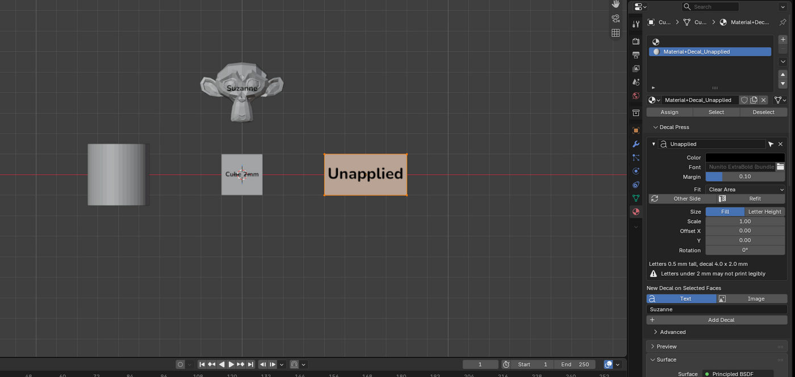
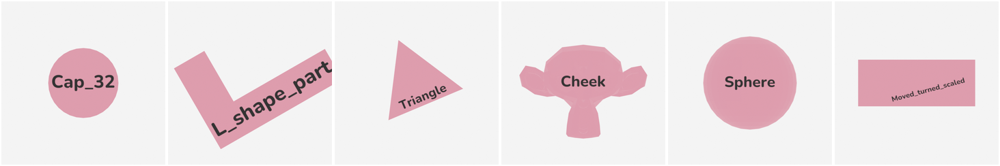

# Decal Press

A Blender add-on that puts text or an image on selected faces as a texture, for full-color 3D
printing (e.g. HP MJF 580): legible labels and logos with no embossing or engraving.

## Features

- **Text decals** that redraw as you type, sized to fill the faces or to a **letter height** in
  mm. Always sharp at print resolution, on a 2 mm face or a 200 mm one, with a warning for letters
  under 2 mm. Bundled Nunito ExtraBold font, or any TTF/OTF.
- **Image decals** from a file or a loaded image, with one color made transparent (tolerance and
  softness), e.g. to drop a white background.
- **Layered over the material** by default: the faces keep their own color or texture and the decal
  sits on top, which exports as a layered 3MF. *Replace Material* is there for tools that can't
  read those.
- **Fits awkward faces:** the decal goes in the largest clear area inside the selection (round,
  triangular, L-shaped, curved), lined up with the faces' straight sides. **Offset**, **Rotation**
  and **Scale** adjust it afterwards.
- **Visible in every shading mode,** including Solid, so no part gets printed with a decal nobody
  saw. The panel lists every decal on the object.
- Everything is packed into the .blend and survives saving and undo.

## Install

Download the zip from [Releases](https://github.com/calvin-young/decal-press/releases), then in
Blender: *Edit → Preferences → Get Extensions → ⌄ → Install from Disk*.

## Use

1. In Edit Mode, select the faces for the decal.
2. *Properties → Material* tab → **Decal Press** panel (right under the material slots) → *New
   Decal on Selected Faces*: pick **Text** and type, or **Image** and pick or open one, then
   **Add Decal**.
3. The panel lists the object's decals: edit text, color, font and margin; for images, **Remove
   Color**. Changes redraw in place. The arrow button selects a decal's faces.
4. Place it: **Fit** (*Clear Area*, or *Whole Selection* to fill the rectangle around the faces),
   **Other Side** to run it along the faces' other side, **Size** (*Fill* with a Scale, or *Letter
   Height* in mm), then **Offset** (mm) and **Rotation**. **Refit** after editing the geometry;
   **×** removes the decal.

Preferences can move the panel to a tab in the 3D Viewport's sidebar instead. *Overlays → Decals*
hides them in Solid shading.

## How it works

Each decal is its own image (`Decal_<text>`, the name the 3MF texture gets), packed into the .blend
with its settings. By default the selected faces get a copy of their material in which a Mix node
(factor = the decal's alpha) blends the decal over the Base Color, read through its own UV map
(`UVMap Layer 1`, ...). [blender-3mf-io](https://github.com/calvin-young/blender-3mf-io)
(layered-textures branch) exports that as a layered 3MF (`multiproperties`). *Advanced → Replace
Material* instead gives the faces an opaque material with the decal drawn on a background color,
which defaults to the faces' previous color.

The UVs are a flat projection along the selection's average normal, so a strongly curved selection
stretches the decal where the surface turns away. See [docs/DECISIONS.md](docs/DECISIONS.md) for
how the fit works and why. Text is drawn with Blender's own `blf` module. 1 Blender unit = 1 mm.

## Status

0.5.0, in development. Tested on Blender 5.2.3 only; declared for 4.5 and newer (`blf.bind_imbuf`
first appears in the 4.5 release notes), but 4.5 is untested
([issue](https://github.com/calvin-young/decal-press/issues)). Not yet printed from a file
exported by this add-on. Version history: [CHANGELOG.md](CHANGELOG.md).

Written almost entirely by Claude (Anthropic) in Claude Code; Calvin Young sets the direction,
tests it and polices the interface. See [docs/PROMPT_STATS.md](docs/PROMPT_STATS.md).

## Contributing

Issues and finished, tested pull requests are welcome: see [CONTRIBUTING.md](CONTRIBUTING.md).
AI agents: start with [AGENTS.md](AGENTS.md).

## License

GPL-3.0-or-later. The bundled Nunito font is under the SIL Open Font License
(`decal_press/fonts/OFL.txt`).
